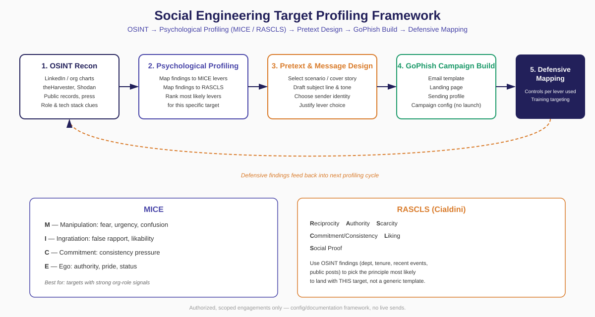

# Social Engineering Target Profiling Framework

**A structured methodology for OSINT-driven target profiling in authorized social engineering engagements — mapping psychological influence models (MICE, RASCLS) to campaign design in GoPhish.**

Built by Frank Stevens ([ChannelXZero](#) · CNM Cybersecurity Faculty) for use in authorized penetration testing engagements and in the classroom (CIST 2887 – Ethical Hacking).

---

## ⚠️ Scope & Authorization

This framework is a **methodology and documentation tool**, not an attack toolkit. It is intended for:

- Authorized penetration testing engagements with signed scope and rules of engagement
- Academic instruction in a controlled lab environment
- Security awareness program design

It explicitly assumes:
- Written authorization exists before any OSINT collection or campaign build begins
- No campaign is launched against real individuals without that authorization
- All target data collected is handled per the engagement's confidentiality terms

This repository documents **methodology**, not pre-built phishing content for a specific real person or organization.

---

## Overview

Most phishing simulations fail to reflect how real attackers actually work: a real attacker researches a target, selects the psychological lever most likely to work on *that specific person*, and only then builds the campaign. Generic templates skip the research step and the campaign is weaker for it.

This framework has five stages:

1. **OSINT Recon** — gather public information about the target
2. **Psychological Profiling** — map findings to MICE and RASCLS
3. **Pretext & Message Design** — translate the chosen lever into a scenario and message
4. **GoPhish Campaign Build** — configure the technical delivery (template, landing page, sending profile)
5. **Defensive Mapping** — translate the attack back into specific controls and training targets

Stage 5 feeds back into future profiling cycles — this is a loop, not a one-shot process.

---

## Stage 1: OSINT Recon

Collect information about the target within authorized scope. Typical sources:

| Source | What it reveals |
|---|---|
| LinkedIn / org chart | Role, tenure, reporting line, recent job changes |
| Company website / press releases | Org structure, recent initiatives, vendor relationships |
| theHarvester, Shodan | Email format, exposed infrastructure, technology stack |
| Public records / news | Recent events (mergers, layoffs, leadership changes) |
| Social media | Personal interests, communication tone, recent activity |

**Output of this stage:** a short target brief — role, tenure, apparent authority level, recent events relevant to the organization, and any personal details relevant to rapport-building (kept to what's professionally relevant and in scope).

---

## Stage 2: Psychological Profiling — MICE + RASCLS

Two complementary models for selecting the influence lever most likely to work on *this* target.

### MICE

| Lever | Description | Best used when... |
|---|---|---|
| **M**anipulation | Exploits fear, urgency, or confusion | Target is in a role with compliance/deadline pressure (finance, HR, IT) |
| **I**ngratiation | Builds false rapport or likability | Target has a visible, approachable online presence |
| **C**ommitment | Leverages consistency with a prior small action | Target has recently taken a public action (RSVP, survey, policy ack) |
| **E**go | Appeals to pride, authority, or status | Target holds a senior title or was recently promoted/recognized |

### RASCLS (Cialdini's principles of influence)

| Principle | Description | Best used when... |
|---|---|---|
| **R**eciprocity | Target feels obligated to return a favor | A prior "gift" or favor can be referenced (training credit, free resource) |
| **A**uthority | Target defers to apparent position/credentials | Impersonating IT, legal, or executive leadership |
| **S**carcity | Limited time or availability drives action | Deadline-driven departments (finance close, enrollment periods) |
| **C**ommitment/Consistency | Same as MICE's C — ties to a prior stated position | Target has made a relevant public commitment |
| **L**iking | Target is more persuadable by people they like | Internal team identity can be mimicked (same department, same vendor) |
| **S**ocial Proof | "Everyone else is doing this" | Rollout/adoption campaigns ("98% of staff have already completed this") |

**Profiling step:** for each target, score which 1–2 levers (from either model) best fit the OSINT brief, and discard the rest. A campaign designed around the wrong lever for a given target underperforms even with excellent technical execution.

---

## Stage 3: Pretext & Message Design

Using the selected lever(s), draft:

- **Scenario/cover story** — what is the sender claiming to be, and why are they reaching out now?
- **Subject line** — should signal the chosen lever directly (urgency → deadline language; authority → sender title; ego → recognition/exclusivity language)
- **Sender identity** — internal (IT, HR, a colleague) or external (vendor, partner) — chosen based on what the OSINT brief suggests the target would trust
- **Call to action** — the single action the message asks for

Document *why* this design choice maps to the lever selected in Stage 2 — this justification is what separates a professional engagement from guesswork, and it's what you'll be graded on if this is for coursework.

---

## Stage 4: GoPhish Campaign Build (Configuration Only)

Translate the Stage 3 design into GoPhish's configuration objects:

| GoPhish Object | What goes here |
|---|---|
| Email Template | Subject line + body from Stage 3 |
| Landing Page | Mimics the service/identity referenced in the pretext |
| Sending Profile | Sender identity and domain from Stage 3 |
| Campaign | Ties the above together — **do not launch without explicit written authorization and defined scope** |

> In a classroom or portfolio context, this stage stops at configuration and screenshots — no campaign is sent. See your engagement's rules of engagement (or your course's lab instructions) for what's authorized.

---

## Stage 5: Defensive Mapping

For each lever used, document the corresponding defense:

| Lever Used | Technical Control | Organizational Control |
|---|---|---|
| Manipulation (urgency) | Email gateway flagging urgency language | Policy: no credential requests via email |
| Authority (RASCLS) | DMARC/SPF/DKIM to block spoofed sender domains | Verify requests from "leadership" via a second channel |
| Ego | — | Awareness training on recognition/exclusivity scams |
| Social Proof | — | Clear internal communication on what legitimate rollouts look like |

This stage is what makes the exercise valuable beyond the campaign itself: the output is a target-specific training recommendation, not a generic phishing awareness slide.

---

## Worked Example: Fictional Target Walkthrough

> **Everything below is synthetic.** "Jane Doe" and "FicCorp" do not exist — this is a demonstration of the framework's output format, not real reconnaissance data.

### Target Brief (Stage 1 output)

| Field | Value |
|---|---|
| Name | Jane Doe (fictional) |
| Title | Finance Manager, Accounts Payable |
| Organization | FicCorp Industries (fictional) |
| Tenure | 14 months — recently promoted from Senior AP Analyst |
| Public signals | LinkedIn post congratulating team on "Q3 close ahead of schedule"; company press release naming her in a new vendor-onboarding initiative |
| Relevant pattern | Finance/AP roles routinely process invoice and payment-change requests — a high-frequency, deadline-driven workflow |

### Lever Selection (Stage 2 output)

| Model | Lever chosen | Why |
|---|---|---|
| MICE | Ego | Recent promotion + public recognition → likely responsive to messages invoking her new authority/visibility |
| RASCLS | Scarcity + Authority | AP workflows are deadline-driven; a message from "leadership" with a short window fits her daily pattern |

*Rejected levers:* Liking (no strong personal social presence to mimic); Reciprocity (no prior "favor" to reference in the brief).

### Pretext Design (Stage 3 output)

- **Scenario:** Email appears to come from the CFO's office, referencing the new vendor-onboarding initiative she was named in, asking her to "confirm" updated banking details for a vendor before a stated cutoff.
- **Subject line:** "Vendor Banking Update — Confirm Before EOD Friday (Action Needed)"
- **Sender identity:** Spoofed "CFO Office" display name
- **Call to action:** Click link → "verify" vendor record → fake landing page requests her AP system login

**Justification:** Authority (sender = CFO office) + Scarcity (EOD Friday) directly target the deadline-driven AP workflow identified in Stage 1; Ego is reinforced by referencing the initiative she was named in, making the message feel personally relevant rather than generic.

### GoPhish Mapping (Stage 4 — configuration only, not launched)

| GoPhish Object | Fictional content |
|---|---|
| Email Template | Subject + body above, from-name "CFO Office \<cfo-office@fic-corp-vendors.com\>" |
| Landing Page | Clone of a generic AP/vendor-portal login screen |
| Sending Profile | Lookalike domain `fic-corp-vendors.com` (not the real `ficcorp.com`) |

### Defensive Mapping (Stage 5 output)

| Lever Used | Technical Control | Organizational Control |
|---|---|---|
| Authority (spoofed CFO) | DMARC/SPF/DKIM enforcement to reject spoofed sender domain | Policy: vendor banking changes require verbal confirmation via known phone number, never email-only |
| Scarcity (EOD deadline) | Email gateway flags artificial urgency language | Train AP staff specifically — this role is disproportionately targeted by BEC-style scenarios |
| Ego (recent promotion) | — | Awareness note: public recognition posts (promotions, project wins) increase personal targeting risk |

---

## Mapping to Standards

This framework is designed to sit alongside, not replace, standard frameworks:

- **PTES** — this framework operationalizes the Intelligence Gathering and part of the Threat Modeling phases, specifically for the social engineering vector
- **MITRE ATT&CK** — maps to Initial Access (T1566 Phishing) and Reconnaissance (T1589–T1598 OSINT sub-techniques)
- **NIST CSF** — Stage 5 outputs map to the Protect (PR) and training-related subcategories

---

## License / Use

This methodology document is free to reference and adapt for authorized security engagements and educational use. It does not grant authorization to conduct any engagement — authorization must come from the target organization's own scope documentation.

---

*Maintained by Frank Stevens — CNM Cybersecurity Faculty / ChannelXZero*
